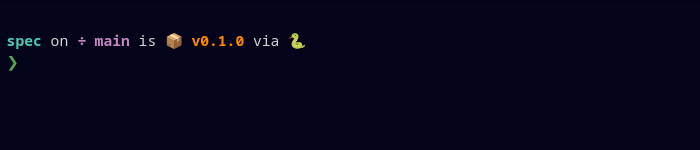

# Deepwick for starship

Deepwick colors for the [starship](https://starship.rs) prompt. The palette
redefines starship's color names (`red`, `purple`, `bright-blue`, …), so every
module's default style picks up Deepwick without further changes.

> Deepwick is an unofficial theme derived from
> [Polywick Blue](https://vscode.polywickstudio.net) by Polywick Studio (MIT).
> Not affiliated with Polywick Studio.



## Install

Put the contents of `deepwick.toml` at the **top** of
`~/.config/starship.toml`, before any `[section]`. Starship reads
`palette = "deepwick"` only at the top level; placed after a section it
silently belongs to that section and the palette is not used.

With no existing config:

```sh
cp deepwick.toml ~/.config/starship.toml
```

## Notes

- A few modules default to 256-color numbers instead of color names (for
  example `package`, `208 bold`); those keep their default color unless you set
  their `style`.

Tested with starship 1.26.0.

## License

MIT. See [LICENSE](LICENSE).
